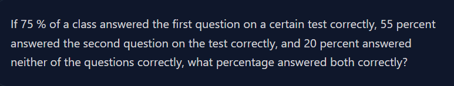

Yep! This one is **not Time & Work**. 😄
This is a **Sets / Venn Diagram** type of question.

And there's a very nice shortcut for it.

### Given:

* **75%** answered Question 1 correctly.
* **55%** answered Question 2 correctly.
* **20%** answered **neither** correctly.
* Find: **% who answered BOTH correctly**

---

## Step 1: Find how many answered at least one correctly

If **20% answered neither**, then everyone else answered **at least one**.

So:

[
100%-20%=80%
]

Therefore:

[
\boxed{80% \text{ answered at least one correctly}}
]

---

## Step 2: Use the formula

Here's the important relationship:

[
\boxed{A+B-(A\cap B)=A\cup B}
]

In simple English:

> People who got Q1 + people who got Q2 − people who got BOTH = people who got at least one.

Put the numbers in:

[
75+55-\text{Both}=80
]

[
130-\text{Both}=80
]

Therefore:

[
\text{Both}=130-80
]

[
\boxed{50%}
]

# 🎯 Answer = 50%

---

### 🧠 But WHY do we subtract the "both"?

This is the part you should understand.

Suppose there are **100 students**.

75 got Q1 right.

55 got Q2 right.

If you simply do:

[
75+55=130
]

That's impossible because there are only 100 students!

Why did we get 130?

Because the students who got **both** questions right were counted **twice**:

> Once inside the 75
> and again inside the 55.

So we need to remove that duplicate counting.

That's why:

[
\boxed{75+55-\text{Both}=80}
]

And we find:

[
\boxed{\text{Both}=50%}
]

---

### 🔥 Shortcut for these questions

Whenever you see:

**A% did X**
**B% did Y**
**C% did neither**

Then:

[
\boxed{\text{Both}=A+B-(100-C)}
]

Here:

[
75+55-(100-20)
]

[
=130-80
]

[
\boxed{50%}
]

This is a **very common aptitude question pattern**, so definitely remember this one.
